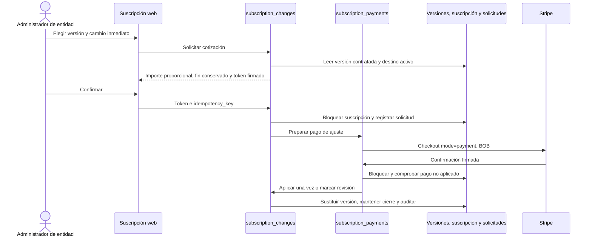
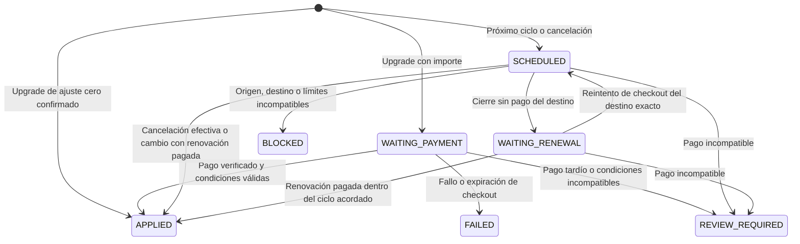
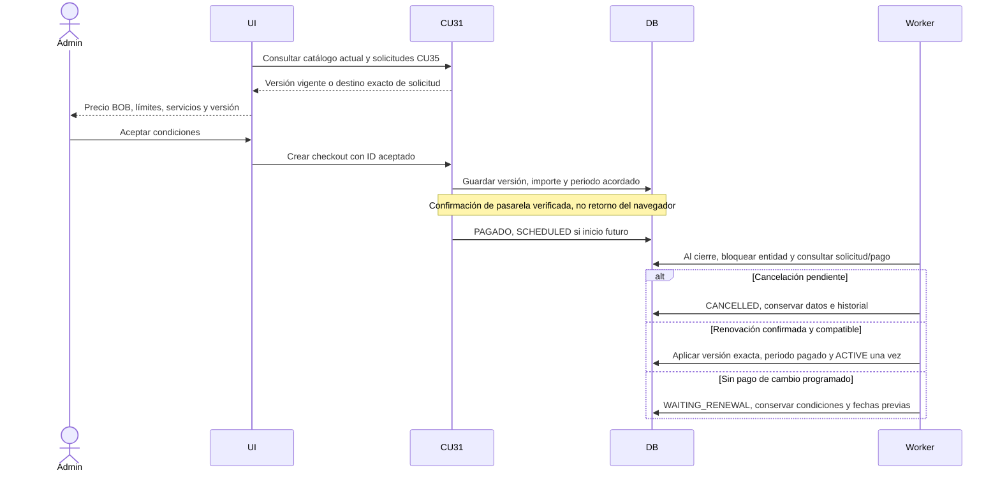

# Diferencias reales con el SDD

Fuente conservada: SI2-Grupo3.md §7.1 (CU34/CU35, criterios 3136/3145) y §7.2.1.4,
§7.2.1.5 y §7.2.1.6: comunicación image151, secuencia image152 y estados image138.
No se sobrescriben imágenes ni la edición del usuario.

- El diagrama de estados admite cancelación inmediata «si está permitido»; la
  decisión posterior la excluye. Solo se confirma cancelación al cierre pagado.
- Secuencia/comunicación describen comprobar pago y aplicar cambio. Se concreta
  con CU31 firmado, instantáneas CU34, bloqueo e idempotencia; no hay nueva pasarela.
- Faltaba ejecutor del cierre en CU31. Se incorpora worker opt-in de 60 segundos.
- CU31 era renovación manual (mode=payment), no suscripción automática de Stripe.
- El usuario concretó «hasta su renovación»: mostrar y aceptar la versión vigente
  del mismo plan, fijarla en el pago y aplicarla solo en el nuevo ciclo pagado.
  Cancelación pendiente impide renovar; cambio pendiente conserva su destino exacto.
- Se confirmó explícitamente bloquear uso clínico desde la cancelación, conservando
  facturación/login. No se desactiva ni elimina la entidad ni sus datos.
- CU30 producía auditorías NULL rechazadas por el CHECK CU34. Se atribuyen a la
  entidad cuando existe; excepción global limitada al rechazo previo al alta y
  al registro de acceso denegado. No se permite auditoría clínica sin entidad.

## Solicitud y pago

## Estados persistidos de la solicitud

La cancelación aplicada deja la suscripción CANCELLED. Sin renovación pagada no
se extiende el ciclo ni se aplica la versión de destino; WAITING_RENEWAL conserva
la fecha efectiva pactada. Con pago confirmado, el siguiente ciclo deja ACTIVE. El guard clínico también comprueba
cancelaciones programadas vencidas para no depender del retraso del worker.

## Renovación y cierre acordado

No se actualizan las imágenes originales: este delta refleja decisiones posteriores
confirmadas y el mecanismo ejecutable. Los tests test_cu35_subscriptions.py cubren
los límites temporales, conservación de snapshots, pagos repetidos, espera y
reintento de renovación y bloqueo clínico por entidad.

## Integración con main actualizado

Se conserva id_version_plan del equipo. La 022 nueva añade estado de aplicación de
pagos, periodo, ancla y solicitudes; no vuelve a crear el catálogo ni las columnas
canónicas. Un guard anterior a 020 evita nuevos mappings por nombre. La evidencia
de mappings antiguos se conserva; las correcciones de FK requieren mapas por
suscripción/pago y condiciones verificadas. Ver subscriptions.md y el informe de
revisión para restricciones de despliegue. CU18 fue recuperada en main (d952a29c):
023 converge merge_cu18_asistencia_022 y cu35_integracion_022 sin reescribirlas.
No hay solapamiento de tablas CU18 con subscription_changes; las columnas,
tipos, nulabilidad y longitudes CU18 coinciden entre Neon leído y PostgreSQL local.
No se certificó igualdad completa de datos, defaults, triggers o índices remotos.
La suscripción/pago canónicos conservan sus IDs de versión. Su ancla original no
está acreditada: billing_anchor_map sigue siendo un requisito de despliegue,
no una inferencia a partir del día de la fecha actual. Renovación sin ancla
verificada se rechaza; no se inventa el dato al iniciar checkout.
